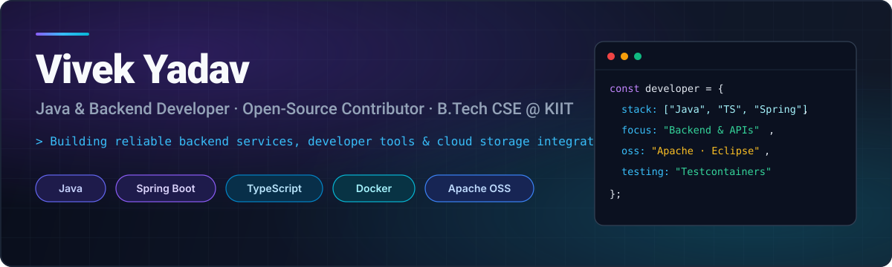

  

  
  
  

---

## 🛠️ Tech Stack

  

  <code>Java &amp; OOP</code> · <code>Spring Boot</code> · <code>REST APIs</code> · <code>SQL &amp; NoSQL</code> · <code>Integration Testing (Testcontainers)</code> · <code>System Design &amp; DSA</code>

---

## 🚀 Featured Projects

  
  

  
  

---

## 🌍 Open-Source Contributions

| Organization / Project | Contributions & Impact | Status |
| :--- | :--- | :--- |
| **Apache Fineract** | [PR #6991](https://github.com/apache/fineract/pull/6991) & [PR #6994](https://github.com/apache/fineract/pull/6994) merged; [PR #7003](https://github.com/apache/fineract/pull/7003) (`FINERACT-3315`) campaign NPE fix | **2 Merged · 1 LGTM** |
| **Apache DolphinScheduler** | [PR #18817](https://github.com/apache/dolphinscheduler/pull/18817): Recursive GCS directory deletion, cross-platform key normalization & `fake-gcs-server` Testcontainers suite | **Maintainer Approved** |
| **Eclipse SW360** | [Backend PR #4836](https://github.com/eclipse-sw360/sw360/pull/4836) & [Frontend PR #2225](https://github.com/eclipse-sw360/sw360-frontend/pull/2225) | **Open · ECA Passed** |
| **Proofline TypeScript SDK** | [PR #69](https://github.com/prooflinedev/sdk-typescript/pull/69): Improved HTTP transport error handling and preserved original error causes | **Submitted** |

---

## 📊 GitHub Activity

  
  

  

  

